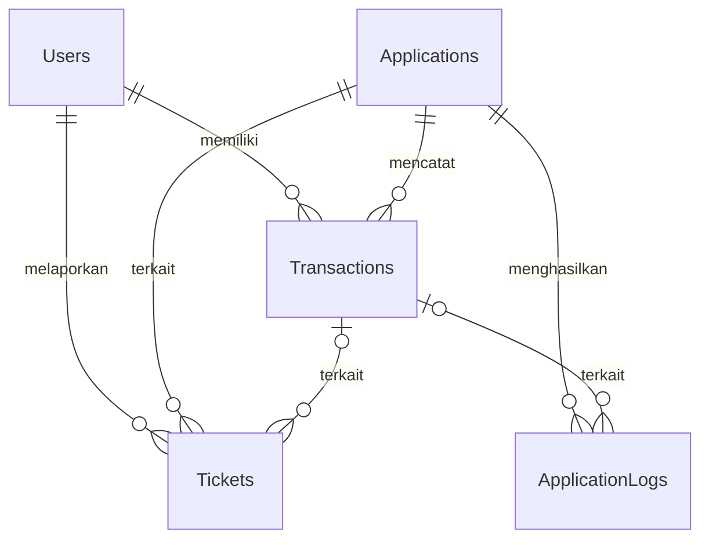

# SQL Server Support Lab

Proyek latihan SQL Server untuk memahami query dan investigasi awal pada pekerjaan First Level / Application Support. Data dan skenario bersifat sintetis; bukan sistem produksi atau soal resmi perusahaan tertentu.

## Teknologi

- Microsoft SQL Server 2025 Express (atau versi SQL Server yang mendukung sintaks skrip).
- SQL Server Management Studio (SSMS).
- Transact-SQL (T-SQL).

## Isi database awal

| Tabel | Jumlah baris | Primary key |
|---|---:|---|
| Users | 15 | UserID |
| Applications | 5 | ApplicationID |
| Transactions | 40 | TransactionID |
| Tickets | 25 | TicketID |
| ApplicationLogs | 15 | LogID |
| **Total** | **100** | |

Tanggal data November 2026, nominal transaksi dalam rupiah. Waktu disimpan sebagai waktu WIB tanpa offset. Untuk soal SLA, gunakan waktu acuan tetap `2026-11-07T12:00:00` agar latihan dapat diulang.

## Cara menjalankan di SSMS

1. Sambungkan SSMS ke SQL Server lokal. Jika instance yang terpasang bernama SQLEXPRESS, gunakan `localhost\SQLEXPRESS` dengan Windows Authentication.
2. Pilih **File > Open > File**, lalu buka `database/setup.sql`.
3. Klik **Execute** untuk menjalankan seluruh skrip. Akun memerlukan izin membuat database jika database belum ada.
4. Periksa Results: data awal seharusnya menghasilkan `TotalRows = 100`.
5. Pada Object Explorer, klik kanan **Databases > Refresh**, lalu buka **SupportInterviewLab100 > Tables**.
6. Klik kanan database tersebut > **New Query** untuk menulis query, atau buka file latihan melalui **File > Open > File** dan klik **Execute**.

Skrip setup tidak menghapus data. Jika kelima tabel sudah ada, pengisian dilewati dan data yang ada dipertahankan. Jika baru sebagian tabel ada, skrip berhenti. Karena itu, menjalankan ulang setup tidak mengembalikan data yang sudah diedit ke kondisi awal dan tidak memperbaiki struktur tabel yang berbeda. Angka 100 hanya berlaku untuk fixture awal.

## Struktur proyek

| File | Kegunaan |
|---|---|
| database/setup.sql | Struktur tabel, 100 baris data awal, verifikasi, dan soal |
| latihan/01_dasar.sql | SELECT, filter, tanggal, pengurutan, dan agregasi |
| latihan/02_join.sql | INNER JOIN, LEFT JOIN, dan investigasi transaksi |
| latihan/03_insert.sql | INSERT sementara dengan ROLLBACK |
| docs/SOAL.md | Daftar soal bertahap tanpa kunci jawaban |

## Hubungan tabel

`TransactionID` pada Tickets dan ApplicationLogs boleh NULL. Satu transaksi dapat mempunyai banyak tiket atau log, sehingga JOIN dapat menghasilkan beberapa baris untuk transaksi yang sama. FK UserID pada Tickets mengacu pada pengguna yang melapor; tidak harus sama dengan pemilik transaksi.

## Fokus pembelajaran

- Memilih kolom, mencari referensi, memfilter status/nominal/tanggal.
- Memahami primary key dan foreign key.
- Menggabungkan transaksi dengan nama pengguna dan aplikasi.
- Menghitung ringkasan transaksi dan mencari pengguna tanpa transaksi.
- Menelusuri log timeout, tenggat SLA, dan bukti untuk eskalasi.
- Mengenal View, Stored Procedure, Function, dan dasar index melalui soal lanjutan.

Skrip latihan adalah contoh pembelajaran, bukan klaim bahwa semua materi telah dikuasai. SQL Server Express tidak menyediakan SQL Server Agent; soal job cukup berupa desain atau dipraktikkan pada edisi yang mendukung.

## Validasi dan batasan

Fixture awal sudah berhasil dijalankan di SQL Server/SSMS selama sesi latihan dan menghasilkan total 100 baris. Jumlah fixture serta relasi dan constraint data juga diperiksa secara lokal. Revisi setup menambahkan perlindungan untuk menjalankan ulang dan memperbaiki alias kolom; revisi lengkap serta seluruh latihan tambahan belum diuji ulang langsung pada mesin SQL Server dalam lingkungan penyusunan paket ini.

Timeout adalah gejala. Data contoh tidak cukup untuk membuktikan akar masalah atau hasil query tuning. Penambahan pengguna melalui SSMS di komputer pribadi tidak otomatis masuk ke repository ini; paket menggunakan fixture sintetis awal.
